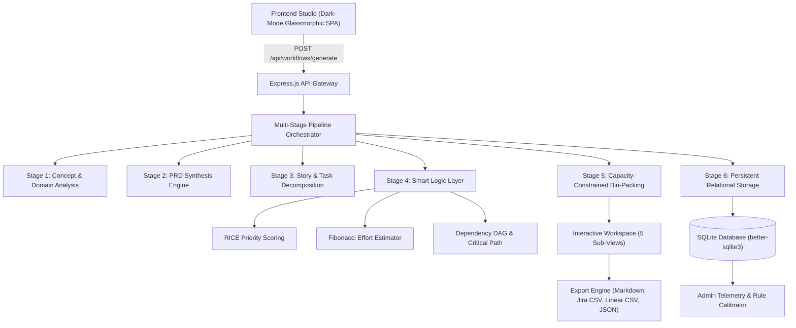

# ⚡ SprintForge AI — PRD → Sprint Planner
> **Autonomous Full-Stack Workflow Automation Platform**  
> *Track: Tech / Product | PRD → Sprint Planner*

---

## 🌟 Executive Overview

**SprintForge AI** is an enterprise-grade workflow automation platform that transforms raw, unstructured product feature ideas into production-ready **Product Requirement Documents (PRDs)**, atomic **User Stories** with Gherkin acceptance criteria, granular **Engineering Tasks**, and **Capacity-Balanced Sprint Roadmaps** with topological dependency resolution.

Modern engineering organizations lose dozens of hours every sprint cycle drafting specifications, estimating story points, identifying prerequisites, and balancing sprint capacities. SprintForge AI provides an automated decision-making pipeline combining domain heuristics, mathematical priority scoring (RICE), directed acyclic graph (DAG) cycle detection, and SQLite persistence.

---

## 🏗️ Architecture & Pipeline Flow



---

## 🚀 Key Modules & System Capabilities

### 1. Frontend: Structured Input & Output Studio
- **Curated Architectural Presets**: Instant one-click presets for rapid prototyping:
  1. *AI Customer Support Copilot* (Sentiment analysis, auto-categorization, escalation)
  2. *Real-time Collaborative Whiteboard* (Multiplayer cursors, CRDT sync, sticky notes)
  3. *Subscription Billing & Invoicing Engine* (Stripe webhooks, tiered plans, metered usage)
  4. *Biometric Zero-Trust Auth Gateway* (FIDO2 WebAuthn, adaptive risk step-up)
- **Granular Parameter Control**: Target audience, tech stack preferences, team velocity capacity slider (15-60 pts), and risk profile buffering (Balanced, Conservative, Aggressive).
- **Animated Stepper**: Real-time 6-stage pipeline execution indicator.
- **5-in-1 Output Workspace**:
  1. **PRD Viewer**: Clean structured specification with Executive Summary, Problem Statement, Target Personas (Pain vs Desired Outcome), Functional Requirements table (Must/Should/Could), Non-Functional Specs (Latency, Security, SLA, Observability), and KPI impact table.
  2. **User Stories & Criteria**: Atomic cards formatted as *Given-When-Then* Gherkin scenarios with business value ratings.
  3. **Engineering Task Matrix**: Full filterable table by Category (`Database`, `Backend`, `Frontend`, `DevOps/Infra`, `QA/Testing`) and Priority (`P0` to `P3`), complete with Story Points, Estimated Hours, RICE breakdown, and prerequisite tags.
  4. **Sprint Execution Board**: Kanban-style sprint buckets balancing tasks into 4 sequential execution phases with live visual velocity capacity meters.
  5. **Interactive Dependency DAG**: Dynamic SVG canvas visualizing topological layers, directed prerequisite arrows, and glowing Critical Path nodes with hover/click inspection.

### 2. Backend & Smart Logic Layer
- **RICE Priority Engine**:
  $$\text{RICE Score} = \frac{\text{Reach} \times \text{Impact} \times \text{Confidence}}{\text{Effort}}$$
  Automatically maps scores into quartile priority tiers (`P0 - Critical`, `P1 - High`, `P2 - Medium`, `P3 - Low`).
- **Fibonacci Effort Estimator**:
  Calculates story points ($1, 2, 3, 5, 8, 13$) and converts them to engineering hours based on domain complexity and team risk tolerance.
- **Topological DAG & Critical Path Engine**:
  Builds directed dependency graphs, checks for circular dependencies, computes topological layers, and pinpoints the longest critical path through the project.
- **Sprint Bin-Packing Allocator**:
  Schedules tasks into sequential sprint buckets respecting prerequisite ordering and team velocity thresholds.

### 3. Database & Relational Persistence
- **Engine**: SQLite via high-performance `better-sqlite3` with Write-Ahead Logging (`WAL`) enabled.
- **Tables**:
  - `workflows`: Stores workflow IDs, feature prompts, PRD data, stories, tasks, sprints, metrics, and approval status.
  - `execution_logs`: Stage-by-stage execution latency, engine type, status, and diagnostic telemetry.
  - `system_config`: Dynamic configuration for team velocity, RICE factor weights, and sprint limits.

### 4. Admin & Monitoring Dashboard
- **Aggregate Metrics**: Total workflows generated, total story points planned, average execution latency (ms), and sprint capacity utilization percentage.
- **Canvas Visualizations**: Real-time category distribution bar chart and priority donut breakdown chart.
- **Workflow Lifecycle Governance**: Update workflow status (`Draft`, `In Review`, `Approved`, `In Sprint`, `Completed`) or view/delete blueprints.
- **Execution Telemetry Feed**: Audit trail tracking individual pipeline stage durations in milliseconds.
- **Live Dynamic Rule Calibrator**: Fine-tune sprint velocity or RICE mathematical weights on the fly without server reboots!

---

## 🛠️ Technology Stack

| Layer | Technologies Used |
| :--- | :--- |
| **Frontend** | Vanilla HTML5, Vanilla CSS3 (Custom Design Tokens, Glassmorphism), ES6+ JavaScript, SVG DAG Canvas, HTML5 Canvas Charts |
| **Backend** | Node.js (v24), Express.js (v4), RESTful Architecture |
| **Database** | SQLite3 (`better-sqlite3`), WAL mode, Relational Schema |
| **Logic & AI** | Hybrid Heuristic Deconstruction Engine, RICE Mathematical Engine, Kahn's Topological Sorting Algorithm |
| **Exporters** | Markdown (`.md`), Jira CSV (`.csv`), Linear CSV (`.csv`), Raw JSON (`.json`) |

---

## 💻 Local Setup & Quick Start

### 1. Prerequisites
- Node.js (v18 or higher)
- npm (v9 or higher)

### 2. Installation
```bash
# Clone the repository
git clone <repo-url>
cd Prd-App

# Install dependencies
npm install
```

### 3. Running the Application
```bash
# Start the full-stack server
npm start
```
The server will start on port `3000`:
- **Web UI & Studio**: [http://localhost:3000](http://localhost:3000)
- **Admin Dashboard**: [http://localhost:3000#admin](http://localhost:3000#admin)
- **Health Check**: [http://localhost:3000/api/health](http://localhost:3000/api/health)

---

## 📡 REST API Reference

| Method | Endpoint | Description |
| :--- | :--- | :--- |
| `POST` | `/api/workflows/generate` | Executes the 6-stage pipeline and creates a new workflow blueprint |
| `GET` | `/api/workflows` | Lists saved workflows with search & status filters |
| `GET` | `/api/workflows/:id` | Retrieves complete PRD, stories, tasks, and sprint data for an ID |
| `PATCH` | `/api/workflows/:id/status` | Updates approval status (`Draft`, `Approved`, etc.) |
| `DELETE` | `/api/workflows/:id` | Deletes a workflow and associated execution logs |
| `GET` | `/api/workflows/:id/export/:format` | Downloads export file (`markdown`, `jira`, `linear`, `json`) |
| `GET` | `/api/admin/metrics` | Fetches aggregate analytics and metric distributions |
| `GET` | `/api/admin/logs` | Fetches recent pipeline stage execution logs |
| `GET` | `/api/admin/config` | Retrieves dynamic system rules |
| `PUT` | `/api/admin/config` | Updates dynamic scoring rules live |

---

## 📈 Git Development Progression

- **Stage 1**: `feat(stage-1): initialize project structure and SQLite persistent storage layer`
- **Stage 2**: `feat(stage-2): implement AI/rule engine, RICE scoring, DAG dependency detection, sprint bin packing, and REST API`
- **Stage 3**: `feat(stage-3): build modern dark-mode frontend, PRD viewer, stories, task matrix, and interactive sprint board`
- **Stage 4**: `feat(stage-4): implement interactive SVG dependency DAG, admin monitoring dashboard, canvas charts, and export hub`
- **Stage 5**: `feat(stage-5): end-to-end integration, dynamic rule tuner, and comprehensive documentation`
